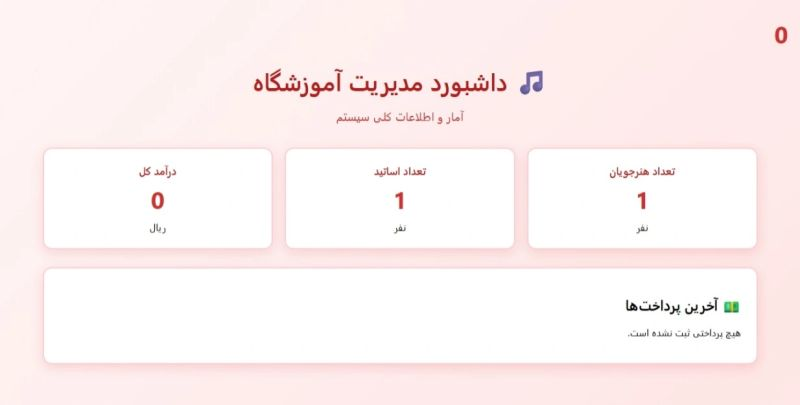
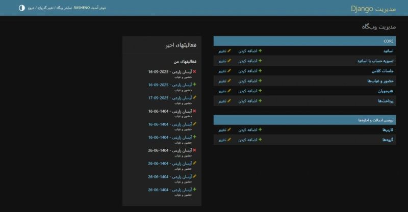
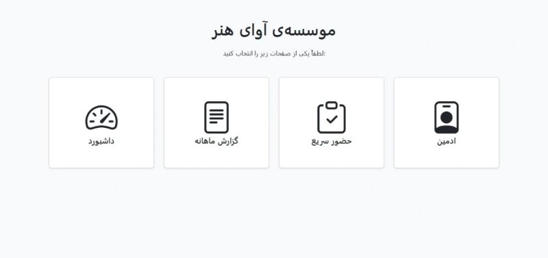

# Music Academy Management

A Django app for the day-to-day paperwork of a small music academy: student and teacher records, attendance, tuition payments, teacher settlements and monthly reports. The interface is in Persian and uses the Jalali calendar.

It is built for internal use on a single machine, with admin-only access.

## Why I built this

Before this app, the academy tracked attendance, tuition and teacher shares by hand. By the end of each month nobody could say for sure how many sessions each student had attended, who had paid, or how much the academy had actually earned, and the month-end numbers were a mess.

I built this to put all of that in one place. Attendance is recorded as classes happen, payments are logged against students, and the monthly report works out each teacher's share and the academy's net profit from the same records, so the numbers at the end of the month come from data instead of memory.

## Features

- **Teacher and student records**, managed through the Django admin.
- **Quick attendance entry**: a dedicated admin page for marking a class session's attendance in one go.
- **Tuition and teacher settlements**: tracks payments and works out each teacher's share.
- **Monthly report**: calculates each teacher's share and the academy's net profit, and exports the results to Excel (pandas and openpyxl).
- **Dashboard** with a summary of teachers, students, attendance and payments.
- **Persian interface with Jalali dates**, including a custom `PersianMonthField` for storing Persian month names.

## Screenshots







## Tech stack

- Python 3.10+ (developed on 3.11)
- Django 5.2
- SQLite
- pandas and openpyxl for Excel reports
- jdatetime and django-jalali-date for Jalali dates
- python-dotenv for configuration

## Data model

| Model | Purpose |
| --- | --- |
| `Teacher` | Teachers at the academy |
| `Student` | Enrolled students |
| `ClassSession` | A single class session |
| `Attendance` | Attendance record for a student in a session |
| `Payment` | Tuition payments |
| `TeacherSettlement` | Payouts to teachers |
| `Invoice` | Invoices |


## Getting started

These steps are for Windows. On macOS or Linux, activate the virtual environment with `source venv/bin/activate` and use `cp` instead of `copy`.

1. Clone the repository and move into it:

   ```
   git clone https://github.com/Parmissat/music-academy-management.git
   cd music-academy-management
   ```

2. Create and activate a virtual environment:

   ```
   python -m venv venv
   venv\Scripts\activate
   ```

3. Install the dependencies:

   ```
   pip install -r requirements.txt
   ```

4. Create your `.env` file from the example:

   ```
   copy .env.example .env
   ```

   Then generate a secret key and paste it into `.env` as the value of `SECRET_KEY`:

   ```
   python -c "from django.core.management.utils import get_random_secret_key; print(get_random_secret_key())"
   ```

5. Create the database and an admin account:

   ```
   python manage.py migrate
   python manage.py createsuperuser
   ```

6. Start the development server and open http://127.0.0.1:8000/ in your browser:

   ```
   python manage.py runserver
   ```

## Project structure

```
.
├── config/                  # Django settings, URLs, WSGI
├── core/                    # The main app
│   ├── models.py
│   ├── admin.py
│   ├── views.py
│   ├── utils.py             # Excel report helpers
│   └── templates/
├── admin_site.py            # TODO: one-line description
├── manage.py
├── run_server.py            # TODO: one-line description
├── run_academy_server.bat   # TODO: one-line description
├── requirements.txt
└── .env.example
```

## Notes

- There is no public sign-up. Accounts are created by an administrator.
- The app is meant to run on the academy's own computer, without an internet connection.
- It runs on Django's built-in development server, which is fine for a single internal machine but is not set up for public hosting.
- All pages and dates are shown in Persian with the Jalali calendar.

## Author

Built by [Parmis Sattari](https://github.com/Parmissat).

## License

See [LICENSE.md](LICENSE.md).